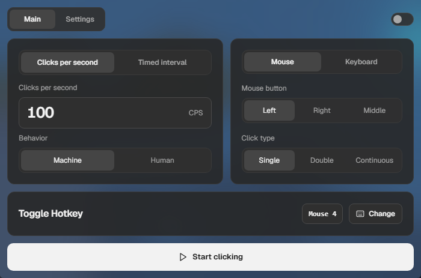

# vibeclicker

vibeclicker is the autoclicker built for me and my friends based on what we've been wanting in an autoclicker. After the downfall of The Fastestest Mouse Clicker for Windows due to reported malware, I had been using a simple Python autoclicker ran from terminal. Well, eventually I got tired of having to run it that way and decided to make a big boy autoclicker. 

vibeclicker runs a Rust backend w/ Tauri v2 to build the UI using Tailwind CSS. Definitely not the most RAM efficient autoclicker out there, but I haven't ran a RAM constricted system for gaming in quite some years, so.

<p align="center">
  
</p>

## Develop

For development, install Node.js and Rust, then run:

```powershell
npm install
npm run tauri dev
```

The Rust/Tauri app lives in `src`; the frontend is in `ui`. The production executable bundles the compiled frontend, so end users do not need Rust or Node.js installed. The Geist font is bundled with the app as well.

## Build for Windows

```powershell
npm run tauri build
```

Installers are written under `src/target/release/bundle`. Tauri's Windows installer bundler needs WiX; if network access is unavailable to download it, `npm run tauri build -- --no-bundle` builds the app executable without an installer. Windows is the only supported and verified platform; click injection and global hotkeys use Win32 APIs.
