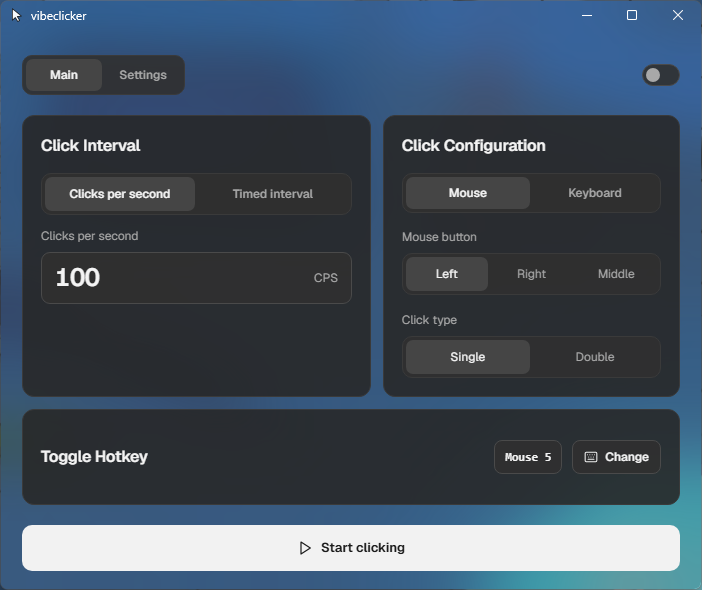

# vibeclicker

A compact Windows autoclicker built with a Rust click engine and a Tauri v2 frontend. The interface uses Tailwind CSS, Lucide icons, and a locally bundled Geist variable font. It follows the system light/dark preference by default and lets users choose an override.



## Develop

For development, install Node.js and Rust, then run:

```powershell
npm install
npm run tauri dev
```

The Rust/Tauri app lives in `src`; the frontend is in `ui`. The production executable bundles the compiled frontend, so end users do not need Rust or Node.js installed. The Geist font is bundled with the app as well.

## Build for Windows

```powershell
npm run tauri build
```

Installers are written under `src/target/release/bundle`. Tauri's Windows installer bundler needs WiX; if network access is unavailable to download it, `npm run tauri build -- --no-bundle` builds the app executable without an installer. Windows is the only supported and verified platform; click injection and global hotkeys use Win32 APIs.

Settings are saved automatically to the local application data directory. The UI includes CPS and interval controls, mouse button and click type selection, keyboard and Mouse 4/5 toggle hotkeys, theme preference, and an always-on-top option.
